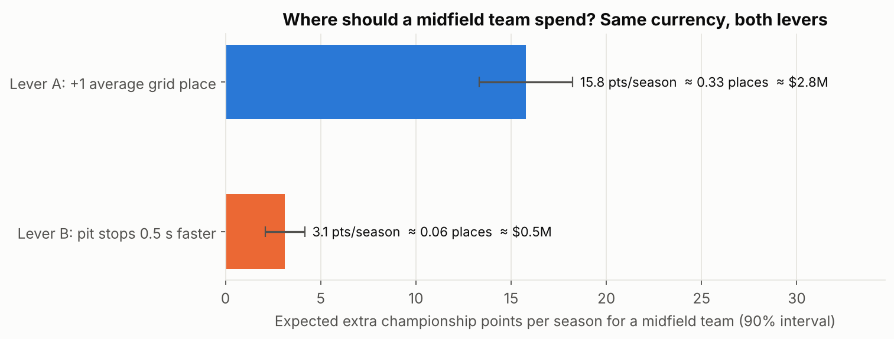
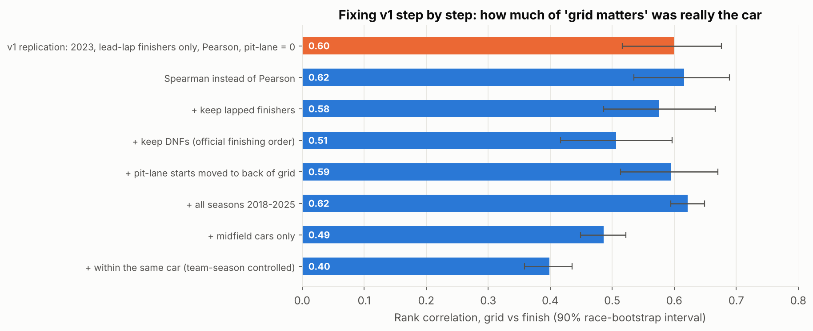

# Qualifying or Race Strategy? Where a Midfield F1 Team Should Spend Its Next Dollar

**Question:** for a midfield Formula 1 team working under the cost cap, is a marginal improvement in **qualifying (grid position)** or in **race-day pit execution and strategy** worth more championship points, and therefore more prize money?

**Data:** 8 seasons (2018–2025), **3,441 car-starts across 173 Grands Prix**, from the open [F1DB](https://github.com/f1db/f1db) database.
**Methods:** fixed-effects regression with splines, race-clustered bootstrap, season re-simulation, time-based out-of-sample validation (train 2018–2024, test 2025), 8 robustness checks.



## Findings

1. **One extra grid place is worth ~15.8 points per season** to a midfield team [90% CI 13.3–18.2]. **Pit stops 0.5 s faster than the field are worth ~3.1** [2.1–4.2]. That makes qualifying about **5x the better lever**.
2. **Break-even:** pit work would need to be **~2.5 s faster per stop** than the field to match one grid place. A whole stationary stop only lasts 2–3 s, so better pit execution can't plausibly close that gap on its own.
3. **In money terms** (prize money is confidential, so this uses a published estimate of $8.5M per constructors' place): lever A ≈ **0.33 places ≈ $2.8M per season**, lever B ≈ 0.06 places ≈ $0.5M. The ranking holds from $5M to $12M per place.
4. **The ranking survives all 8 robustness checks** (different midfield definitions, without 2020, each regulation era, without pit-lane starters, without mechanical DNFs). Lever A is 4.5–6x lever B in every one.
5. **The original v1 finding was inflated.** The grid-finish correlation falls from **0.60 to 0.40** once DNFs, lapped cars and pit-lane starts are handled and the car is held constant.
6. **Out of sample (2025),** grid position alone predicts which midfield cars score better than every alternative tried (Brier 0.184). Adding team form made predictions worse.

Full numbers, tables and intervals: **[`reports/results.md`](reports/results.md)** (generated by code). One-page recommendation: **[`reports/decision_memo.md`](reports/decision_memo.md)**.

## Why this is v2

[v1](v1/) analysed one season (2023) in Tableau and reported r = 0.661 between grid and finish, and r ≈ 0 for pit-stop count. Re-examining it turned up four problems: it **dropped DNFs and every lapped car** (survivorship bias, 31% of rows lost), **coded pit-lane starters as pole position**, **didn't control for car quality**, and **used pit-stop count**, which barely varies, as its "strategy" measure. v2 fixes each one and shows the effect step by step:



## How to run

```bash
pip install -r requirements.txt
python run_pipeline.py     # downloads F1DB once (cached), cleans, builds features
python run_analysis.py     # A1-A6 -> reports/results.md, headline.json, 6 figures (~6 min)
pytest -q                  # 6 tests guarding the cleaning decisions
```

`data/processed/car_starts.csv` is committed, so `run_analysis.py` works without re-downloading anything.

## Method in brief

| Step | What | Why |
|---|---|---|
| Midfield | Constructor rank 4–8 by points over the **previous 5 races only** | Avoids look-ahead; teams move in and out during a season |
| Outcome | Points on a standard 25-18-15…1 scale; DNF = 0 | Points are what the championship and the money are decided on |
| Lever A | OLS of points on a grid-slot spline + team-season fixed effects | Compares the *same car* starting from different slots |
| Lever B | Pit-lane time, stop count and first-stop timing *relative to each race*, plus grid, team-season and race fixed effects | Within-race deltas remove circuit-level pit-lane differences |
| Money | Re-score each season with the lever's gain added; recompute constructors' table | Turns points into championship places and dollars |
| Uncertainty | Race-clustered bootstrap, 500 replicates | Cars in one race aren't independent |
| Validation | Train 2018–2024, test 2025; Brier score, log loss, calibration | A random split would leak the future |

Plain-English explanation for non-F1 readers: **[`details.md`](details.md)**. Build plan, research background and citations: **[`implementation.md`](implementation.md)**.

## Limitations

- **Strategy effects are associational.** Teams choose strategy in response to race events (damage, safety cars), so A3 coefficients aren't causal. The roadmap's safety-car natural experiment addresses this.
- **We estimate returns, not costs.** Whether one grid place costs more or less than 0.5 s of pit time is internal team data. The memo gives a break-even ratio instead.
- **Prize money is an estimate.** The Concorde Agreement is confidential; sensitivity is shown from $5M to $12M per place.
- **Public data only:** no telemetry, fuel loads or live gaps. Results apply to 2018–2025-style cars, not the 2026 regulations.
- **Places intervals** reflect effect-size uncertainty only, conditional on the observed seasons.

## Roadmap

- **Safety-car natural experiment** (FastF1 track status): a causal value of a "cheap" pit stop; separating strategy luck from skill.
- **Tyre-degradation model + Monte Carlo race simulator:** expected points *and risk* for one-stop vs two-stop.
- **Circuit clustering + Streamlit/Tableau dashboard:** a lever recommendation per circuit type.
- **Bayesian hierarchical model** of driver and constructor effects (van Kesteren & Bergkamp, 2023).

## Repository

```
run_pipeline.py / run_analysis.py   entry points
src/f1lever/                        config, data, analysis, report
data/processed/                     car_starts.csv, pit_stops.csv
reports/                            results.md, decision_memo.md, headline.json, figures/
tests/                              cleaning and no-look-ahead guards
v1/                                 original 2023 notebook and Tableau sheets (kept as baseline)
```

Data: F1DB (CC BY 4.0). Author: Harshita Wattal.
