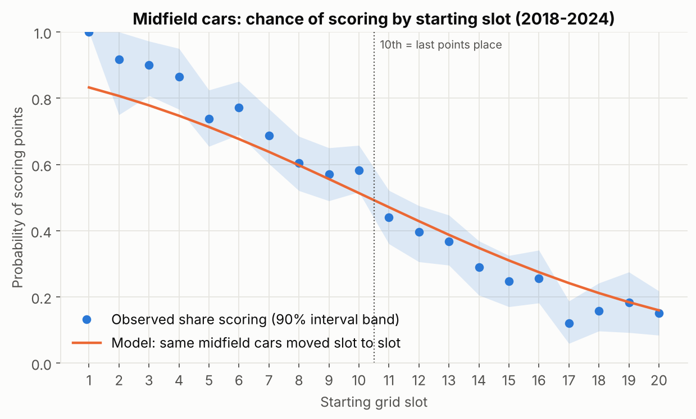
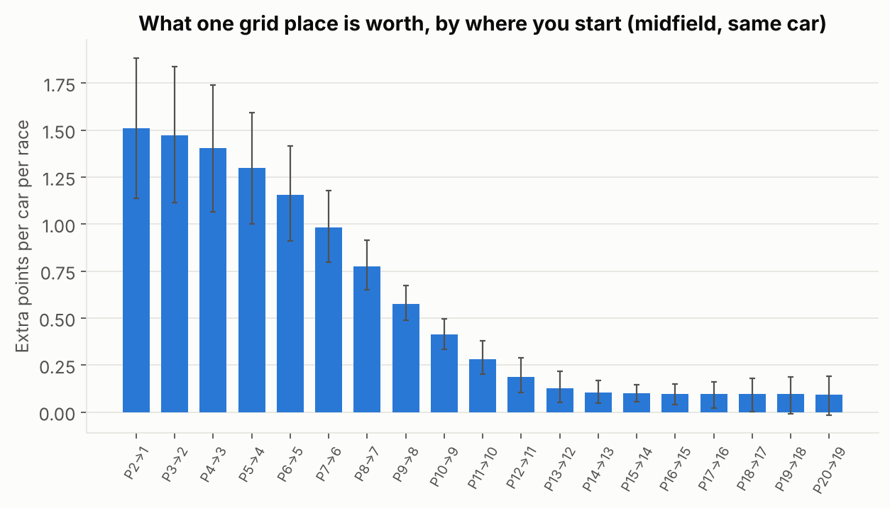
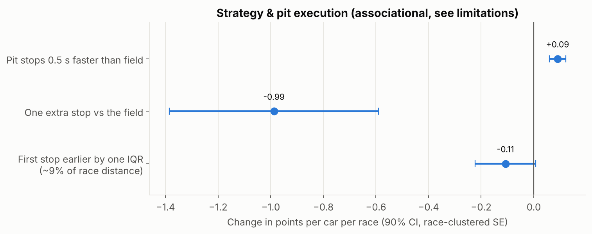
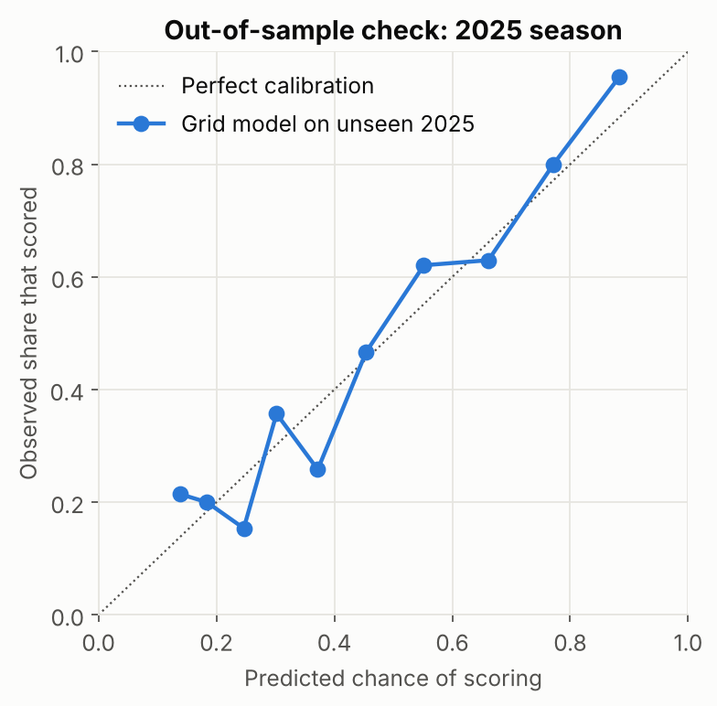

# Results (auto-generated by `run_analysis.py` — do not edit by hand)

Data: F1DB, 2018-2025, **3,441 car-starts in 173 Grands Prix**. Training = 2018–2024, test = 2025. Intervals are 90% race-clustered bootstrap (500 replicates) unless stated.

## Headline

- For a midfield team, **one extra grid place on average is worth 15.8 points per season** 15.8 [13.3, 18.2]; **0.5 s faster pit stops are worth 3.1** 3.1 [2.1, 4.2], about **5x less**.
- Pit work would have to be **2.5 s faster per stop than the field** to match one grid place. A typical stationary stop lasts only 2–3 s, so pit execution alone cannot plausibly close that gap.
- In championship terms: lever A ≈ **0.33 constructors' places per season** (≈ $2.8M at $8.5M/place); lever B ≈ 0.06 places (≈ $0.5M).
- v1's headline correlation shrinks from **0.60 to 0.40** once DNFs, lapped cars and pit-lane starts are handled and the car is held constant.
- Out of sample (2025), the best predictor of a midfield car scoring is **Model: grid only (midfield-trained)** (Brier 0.184). Adding team form did not improve it.

## A1 — Correcting v1 step by step

| Step | n | Rank correlation | 90% interval |
|---|---:|---:|---|
| v1 replication: 2023, lead-lap finishers only, Pearson, pit-lane = 0 | 304 | 0.599 | [0.517, 0.676] |
| Spearman instead of Pearson | 304 | 0.616 | [0.535, 0.689] |
| + keep lapped finishers | 388 | 0.575 | [0.486, 0.666] |
| + keep DNFs (official finishing order) | 436 | 0.506 | [0.416, 0.597] |
| + pit-lane starts moved to back of grid | 436 | 0.594 | [0.513, 0.671] |
| + all seasons 2018-2025 | 3,441 | 0.622 | [0.594, 0.649] |
| + midfield cars only | 1,659 | 0.486 | [0.449, 0.522] |
| + within the same car (team-season controlled) | 1,659 | 0.398 | [0.359, 0.435] |

The original v1 notebook reported r = 0.661 using the Ergast API. Re-running v1's exact filter on F1DB data selects the same 304 rows but gives r ≈ 0.60; the gap reflects source-level grid coding differences. Note: v1's filter (`status == 'Finished' or '+' in status`) also silently dropped every lapped car, because the API labels them 'Lapped'.

## A2 — Value of a grid place (lever A)

Sample: 1,427 midfield car-starts, 149 races, 53 team-seasons. Model: OLS of standard points on a natural cubic spline of grid slot (4 df) with team-season fixed effects (one baseline per car per season).

- Average marginal effect of starting one place higher: **0.461 [0.391, 0.531] points per car per race**.
- The value is highest at the front: P2→P1 is worth 1.51 pts, P8→P7 0.77, P11→P10 0.28, P15→P14 0.10.
- **Pre-registered hypothesis H2 (value steepest around the 10th-place boundary) is not supported in points terms:** the 25-18-15 scale makes front-of-grid gains worth more, even for midfield cars.
- In probability terms the boundary does show: the largest observed drop in the share of midfield cars scoring (P5–P15) is from P10 to P11 (0.58 → 0.44).

| Move | Extra points per car per race | 90% interval |
|---|---:|---|
| P2→P1 | 1.508 | [1.137, 1.884] |
| P3→P2 | 1.473 | [1.113, 1.836] |
| P4→P3 | 1.403 | [1.067, 1.738] |
| P5→P4 | 1.297 | [1.000, 1.594] |
| P6→P5 | 1.157 | [0.911, 1.414] |
| P7→P6 | 0.981 | [0.798, 1.179] |
| P8→P7 | 0.774 | [0.648, 0.914] |
| P9→P8 | 0.576 | [0.489, 0.672] |
| P10→P9 | 0.411 | [0.335, 0.497] |
| P11→P10 | 0.282 | [0.201, 0.378] |
| P12→P11 | 0.187 | [0.104, 0.289] |
| P13→P12 | 0.127 | [0.053, 0.219] |
| P14→P13 | 0.102 | [0.048, 0.169] |
| P15→P14 | 0.099 | [0.055, 0.145] |
| P16→P15 | 0.097 | [0.040, 0.148] |
| P17→P16 | 0.096 | [0.021, 0.162] |
| P18→P17 | 0.095 | [0.001, 0.177] |
| P19→P18 | 0.095 | [-0.010, 0.187] |
| P20→P19 | 0.094 | [-0.015, 0.191] |

## A3 — Strategy and pit execution (lever B)

Sample: 1,279 midfield car-starts that ran ≥50% distance and stopped at least once (148 races). Model: OLS of points on pit-lane time vs race median, stop count vs race mode, first-stop timing vs race median, grid spline, team-season and race fixed effects. Cluster-robust SEs by race.

| Feature | Coef (pts per unit) | Cluster SE | p | Bootstrap 90% |
|---|---:|---:|---:|---|
| Pit-lane time vs race median (per s) | -0.181 | 0.038 | 0.000 | [-0.245, -0.130] |
| Stops vs race mode (per stop) | -0.988 | 0.242 | 0.000 | [-1.345, -0.597] |
| First-stop timing vs race median (per race fraction) | 1.262 | 0.820 | 0.124 | [0.072, 2.578] |

- 0.5 s faster per stop → **0.091 pts per car per race**.
- An extra stop vs the field is associated with -0.99 pts. This is likely reverse causation (unplanned stops for damage or punctures), not evidence that two-stops are bad.
- First-stop timing is not distinguishable from zero with cluster-robust SEs.
- **These are associations.** Strategy reacts to race events; Phase 4 (safety-car natural experiment) is designed to get causal estimates.

## A4 — Lever comparison: points → championship → money

Each training season is re-scored with the lever's expected gain added to every midfield car-start of each team that was midfield in ≥50% of its races (36 team-seasons); other teams unchanged; constructors' table recomputed on the standard points scale.

| | Pts per car-race | Pts per season | Constructors' places per season |
|---|---|---|---|
| A: +1 grid place | 0.461 [0.391, 0.531] | 15.8 [13.3, 18.2] | 0.33 [0.28, 0.44] |
| B: 0.5 s faster stops | 0.091 [0.065, 0.122] | 3.1 [2.1, 4.2] | 0.06 [0.03, 0.06] |

Prize money (assumption, real split is confidential):

| $ per place | Lever A per season | Lever B per season |
|---|---:|---:|
| $5M | $1.67M | $0.28M |
| $8.5M | $2.83M | $0.47M |
| $12M | $4.00M | $0.67M |

Places intervals reflect uncertainty in the effect size only, conditional on the observed seasons; they understate total uncertainty. The **ranking of levers holds at every $ assumption**; only the dollar size changes.

**Break-even:** lever A is worth funding over lever B whenever one average grid place costs less than ≈5x what a 0.5 s pit improvement costs.

## A5 — Out-of-sample validation (train 2018–2024, test 2025)

Test set: 232 midfield car-starts in 24 races. Outcome: scored points.

| Model | Brier (lower = better) | Log loss |
|---|---:|---:|
| Model: grid only (midfield-trained) | 0.1838 | 0.5484 |
| Baseline 0: grid only, all teams | 0.1861 | 0.5559 |
| Model: grid + team form | 0.1929 | 0.5707 |
| Baseline -1: midfield base rate | 0.2470 | 0.6871 |
| Baseline 1: team form only | 0.2554 | 0.7126 |

Grid position alone generalises best; adding rolling team form overfits. This supports the central finding that the grid carries most of the information.

## A6 — Robustness

| Variant | Midfield n | A: pts/car-race | B: pts/car-race | A ÷ B |
|---|---:|---:|---:|---:|
| Baseline (ranks 4-8, 5-race window) | 1,427 | 0.461 | 0.091 | 5.1 |
| Midfield = ranks 3-8 | 1,740 | 0.573 | 0.108 | 5.3 |
| Midfield = ranks 4-9 | 1,746 | 0.425 | 0.071 | 6.0 |
| Excluding 2020 (COVID season) | 1,263 | 0.474 | 0.082 | 5.7 |
| 2018-2021 era only | 782 | 0.422 | 0.075 | 5.6 |
| 2022-2024 era only (new car rules) | 645 | 0.495 | 0.109 | 4.5 |
| Pit-lane starters excluded | 1,396 | 0.461 | 0.094 | 4.9 |
| Mechanical DNFs excluded | 1,323 | 0.478 | 0.087 | 5.5 |

The lever ranking holds in every variant.

(Re-flagged midfield variants recompute rolling form from 2018 onward, so the first few 2018 races have shorter history than the baseline.)
